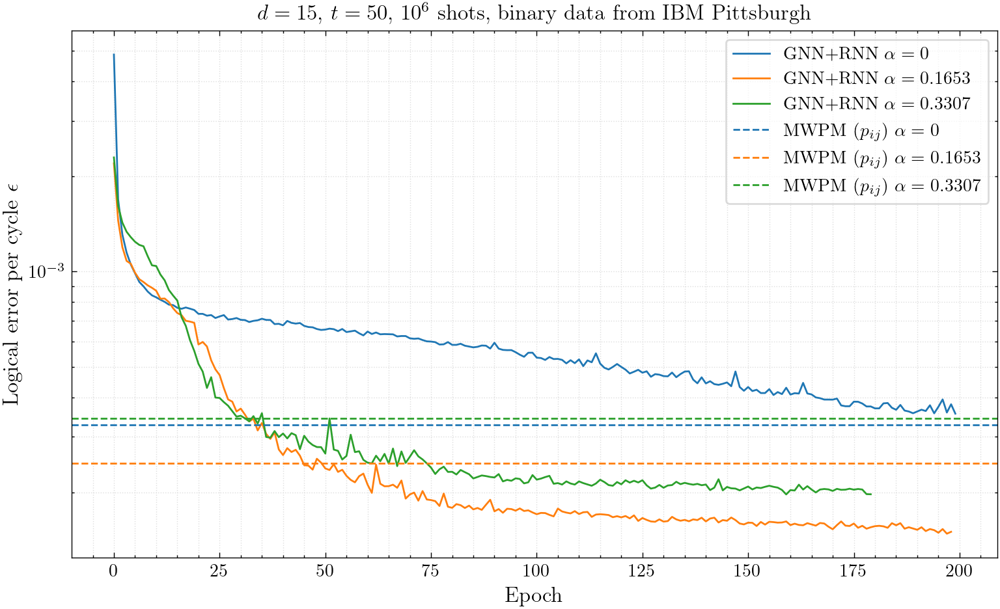
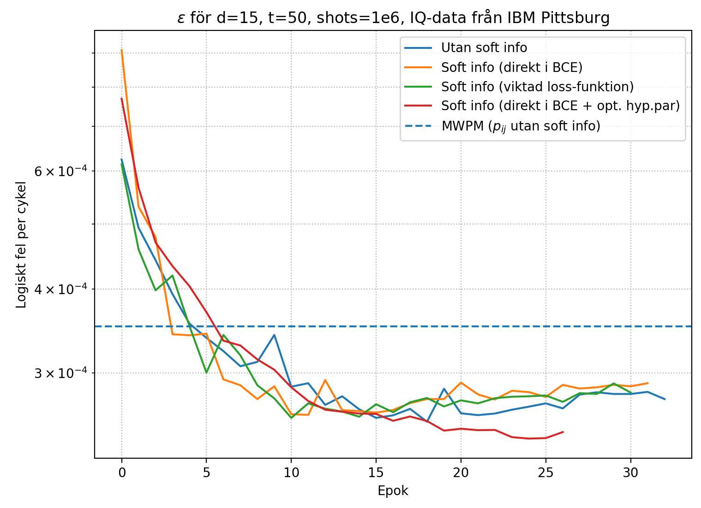
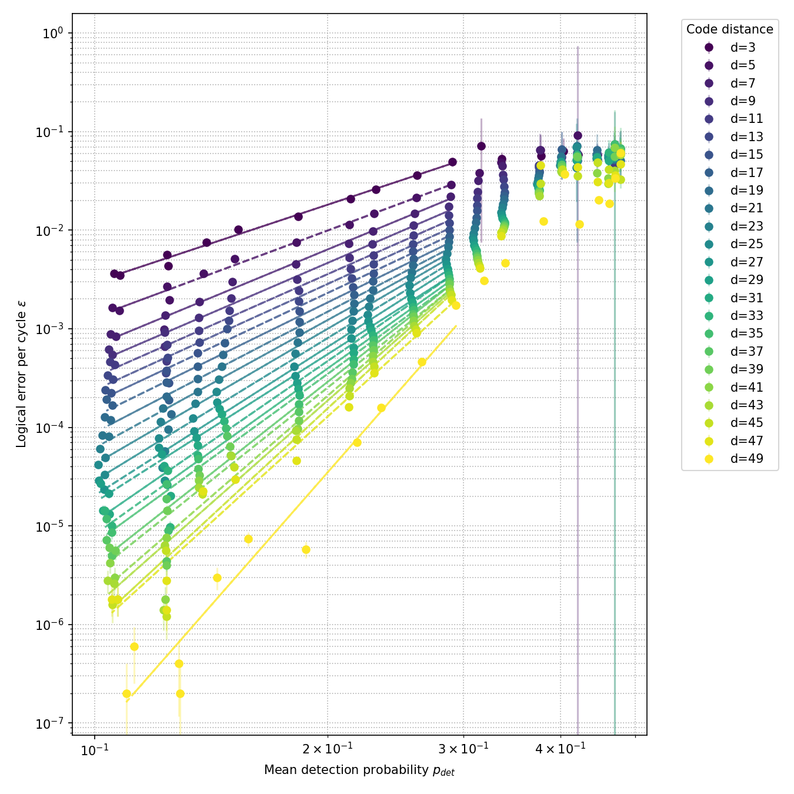
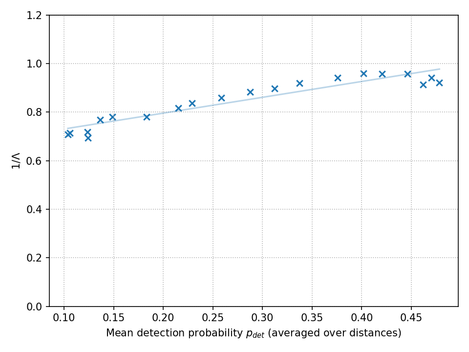
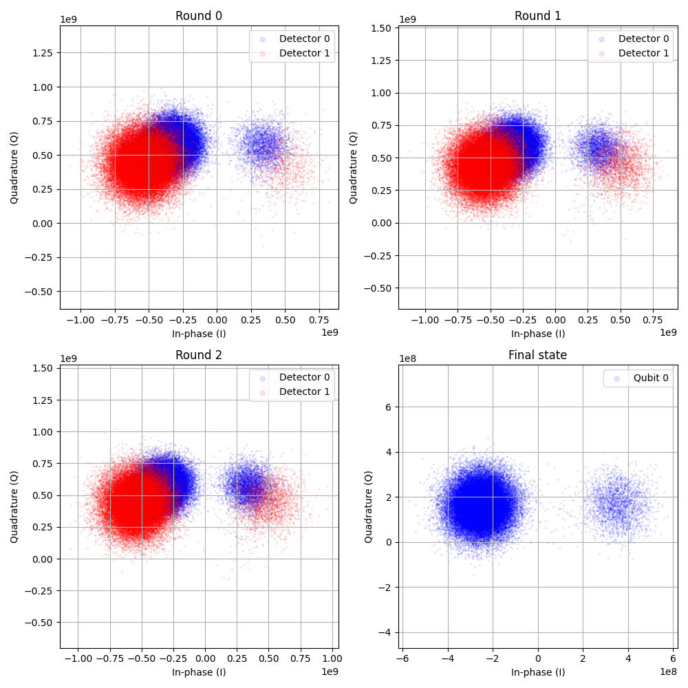
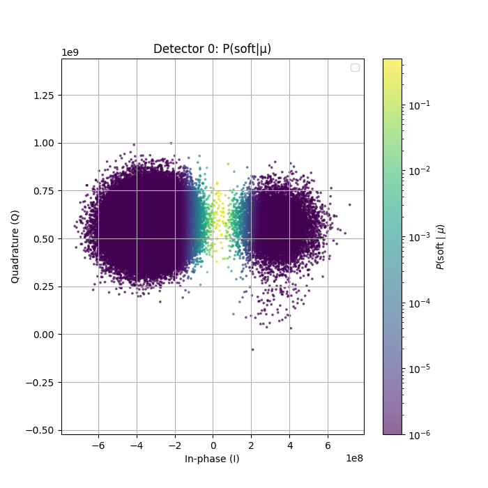
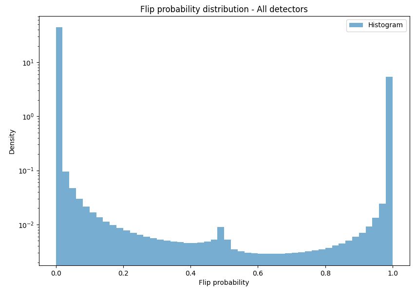
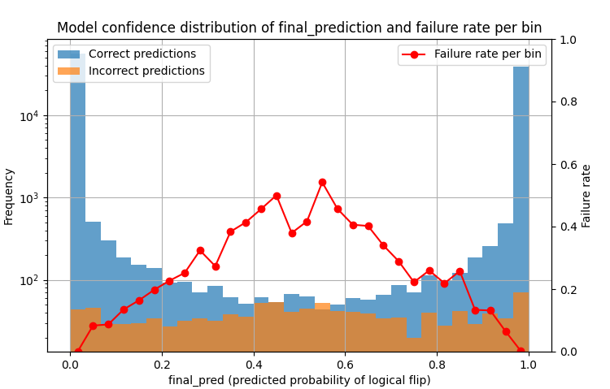
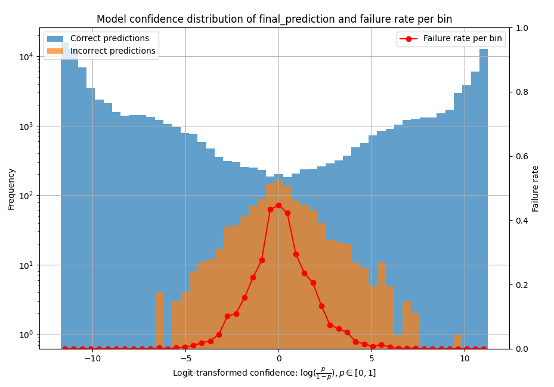

# Data-driven decoding of the repetition code on IBM hardware with GNN+RNN


[](LICENSE)

**Vidar Petersson** · Summer research internship 2025 at [WACQT](https://www.chalmers.se/en/centres/wacqt/) (Wallenberg Centre for Quantum Technology), supervised by Mats Granath and Moritz Lange

I ran repetition-code memory experiments on IBM's superconducting hardware (`ibm_pittsburgh`) and decoded them with a hybrid graph neural network + recurrent neural network (GNN+RNN). The decoder is trained directly on the experimental data and compared against a correlation-weighted MWPM baseline. The project builds on the master's thesis *Sequential Graph-Based Decoding of the Surface Code using a Hybrid Graph and Recurrent Neural Network Model* by Ole Larsen Fjeldså and Gustaf Jonasson Johansson ([Olfj/QEC_GNN-RNN](https://github.com/Olfj/QEC_GNN-RNN)), which used the model on simulated surface-code data.

> The research code and results are from summer 2025. In 2026 I cleaned up the repository for sharing: I translated comments to English, fixed a few bugs, removed unused files, added a `pyproject.toml` and rewrote this README. The commit history shows exactly what changed.

---

## What I did

- **Hardware experiments.** I adapted the repetition-code circuit from [qiskit-qec](https://github.com/qiskit-community/qiskit-qec) (no ancilla reset, optional RZ noise injection) and ran it on `ibm_pittsburgh` through Qiskit Runtime: code distances up to d = 49, up to 50 rounds and 10⁴–10⁶ shots per configuration. Both binary (`classified`) and raw IQ (`kerneled`) readout were collected.
- **Data pipelines.** I built loaders that turn job results into detection events and logical-flip labels, including subsampling of large-distance jobs down to smaller distances, plus graph construction with a sliding time window for the GNN.
- **Soft information from IQ data.** A Gaussian mixture model per measured qubit converts IQ points into probabilities. These probabilities are used both as GNN node features and as soft labels in the loss.
- **MWPM baseline.** I implemented MWPM (PyMatching) with edge weights estimated from pairwise detection-event correlations (p_ij), so the baseline also adapts to the hardware noise.
- **Training.** The GNN+RNN was trained on the Alvis GPU cluster (A40) with early stopping, `ReduceLROnPlateau`, dropout and AdamW to deal with the overfitting seen in the original configuration.
- **Noise scaling analysis.** I injected extra noise with RZ rotations ("turning the knob") and measured how the logical error per cycle scales with the detection probability for d = 3 … 49.

## Key results

### GNN+RNN vs. MWPM on binary hardware data (d = 15, t = 50)

| Noise angle α | GNN+RNN accuracy | GNN+RNN ε per cycle | MWPM (p_ij) accuracy | MWPM ε per cycle | Change in ε |
|---|---|---|---|---|---|
| 0 | 0.98256 | 3.55 × 10⁻⁴ | 0.98393 | 3.27 × 10⁻⁴ | +9 % |
| 0.1653 | 0.99266 | 1.48 × 10⁻⁴ | 0.98777 | 2.48 × 10⁻⁴ | −40 % |
| 0.3307 | 0.99025 | 1.97 × 10⁻⁴ | 0.98318 | 3.42 × 10⁻⁴ | −42 % |

ε is the logical error per cycle, ε = ½(1 − (1 − 2P_L)^{1/T}) with P_L = 1 − accuracy and T = 50.



Caveats:
- The numbers come from a 10 % validation split of each dataset. The best epoch was selected on that same split, and there is no separate test set.
- Each α is a separate hardware run. Because calibration drifted between runs, the rows cannot be compared with each other, only GNN vs. MWPM within a row.
- The α = 0 run stopped at the 200-epoch limit while it was still improving.

Reproduce the figure with `python data_analysis/plot_training_curves.py` (it reads the Weights & Biases export in `data_analysis/training_curves/`).

### Soft information from IQ readout (d = 15, t = 50)

Using the IQ-derived probabilities lowered the logical error per cycle from about 3.5 × 10⁻⁴ (MWPM, hard decisions) to about 2.5 × 10⁻⁴ (GNN+RNN with soft information and tuned hyperparameters). These values are read off the figure below. The plot predates the cleanup and has Swedish labels: *Utan soft info* = without soft information, *direkt i BCE* = soft labels used directly in the binary cross-entropy, *viktad loss-funktion* = weighted loss, *opt. hyp.par* = tuned hyperparameters, *Epok* = epoch, *Logiskt fel per cykel* = logical error per cycle. The underlying run data is not in this repository.



### Scaling with noise strength (MWPM, d = 3 … 49)

 

For an ideal repetition code, ε ∝ p^{(d+1)/2}, so the log–log slope should be (d+1)/2. The measured slopes (fit for p_det < 0.3) agree for d = 3 and d = 5 (2.6 and 2.9). For larger distances they fall far short: about 3.7 for d = 15 compared with 8 expected, and about 9 for d = 49 compared with 25. Why the scaling falls short is one of the open questions below. The right-hand plot shows the error-suppression factor Λ, extracted from the decay of ε with distance at each noise level.

Reproduce both figures with `python data_analysis/plot_threshold_analysis.py`. It reads the MWPM results stored in `data_analysis/data/threshold_analysis.csv`.

---

## Focus areas and open questions

### 1. Decoding IQ data
Based on [arXiv:2411.16228](https://arxiv.org/abs/2411.16228). Instead of binary outcomes, the raw IQ points are kept and a GMM gives P(state = 1) for every measurement. This soft information is used as a node feature and in the loss. Unlike the paper, which fits the classifier on two calibration circuits, I fit the GMMs on the execution data itself.

 



Open questions:
- Replace the GMM classifier with KDE (suggested in the paper).
- Transform the probabilities (e.g. `logit`) to emphasise small differences near 0 and 1.
- Implement a soft-information MWPM decoder for a fairer comparison.

### 2. Turning the knob
Based on [arXiv:2505.22741](https://arxiv.org/abs/2505.22741). Applying an RZ(α) rotation on every data qubit each round raises the detection probability p_det. The hypothesis was that training on noisier data, which shows a wider range of syndromes, would help when decoding less noisy data.

Open questions:
- There is no clear evidence yet that this improves performance.
- Which p_det gives the most useful training data?
- In some runs α ≈ 0.1653 gives a *lower* p_det than α = 0. The cause is unknown and possibly calibration drift between jobs.

### 3. Train-at-all-times
If the logical state is known at every round, the network can be supervised at every time step (`train_all_times=True`). The current datasets contain no intermediate logical measurements, so this has not been tested on hardware data.

### 4. Optimising the GNN+RNN
The architecture and hyperparameters were inherited from the surface-code project. Overfitting after 10–20 epochs was fixed by switching from an exponential LR schedule to `ReduceLROnPlateau`, adding dropout to the GRU and GNN, increasing the batch size to 512 and using AdamW weight decay.

Open questions: further hyperparameter search, batch normalisation, the effect of the window length `dt`, residual connections between GNN layers, and attention after the GRU.

### 5. Threshold and maximum-likelihood analysis
Inspired by [arXiv:2408.13687](https://arxiv.org/abs/2408.13687); see the scaling figures above.

Open questions:
- Explain why the measured slope is far below (d+1)/2 for larger distances.
- Extend the analysis to more rounds.
- Improve the subsampling. Today all length-d chains are merged; each subsampled segment should instead get its own p_ij and be decoded separately.

The distribution of the GNN's final prediction shows that its errors are concentrated where the predicted probability is close to 0.5:

 

---

## Repository structure

```
├── args.py                     # Args dataclass: data, graph and training configuration
├── training_utils.py           # Checkpointing, async batch prefetching, GNN layer, logging
├── repetition_code/
│   ├── repetition_code_circuit.py   # Repetition-code circuit (ancilla reset optional, off by default; optional RZ noise)
│   └── repetition_code_execute.py   # Run on IBM hardware or the Aer simulator and save results
├── decoder_binary/             # Pipeline for binary readout (meas_type="classified")
│   ├── dataloader_ibm.py       #   job JSON -> detection events + logical flips (with subsampling)
│   ├── graph_creator.py        #   sliding-window graphs and batches for the GNN
│   ├── gru_decoder.py          #   GNN+RNN model, training and evaluation
│   └── mwpm_decoder_ibm.py     #   MWPM baseline with correlation-based weights
├── decoder_iq/                 # Same pipeline for IQ readout (meas_type="kerneled")
│   └── GMM_classifier.py       #   IQ -> P(state = 1) per qubit
├── data_analysis/
│   ├── plot_threshold_analysis.py  # Scaling analysis and figures
│   ├── plot_training_curves.py     # GNN vs MWPM training curves
│   ├── data/                       # MWPM results used for the scaling figures
│   └── training_curves/            # Weights & Biases export
├── examples/                   # train_nn.py, test_nn.py, batch_execution_rep_code.py
├── figures/
├── jobdata/ibm/iq_data/        # d = 3 IQ hardware jobs and a calibration snapshot
├── models/                     # Trained GNN+RNN checkpoints (d = 15)
├── job_script.sh, bash_container.def, create_container.sh   # Alvis cluster setup
├── pyproject.toml              # Package metadata and dependencies
└── requirements.txt            # Exact pinned environment used on Alvis (CUDA 12.1)
```

## Getting started

```bash
git clone https://github.com/Vidar-Petersson/QEC_GNN-RNN_IBM.git
cd QEC_GNN-RNN_IBM
pip install -e .
```

This installs the project and its dependencies from `pyproject.toml` (Python ≥ 3.10). `torch-cluster` is a compiled extension that must match your PyTorch and CUDA version. If pip cannot find a wheel, install it first from the [PyG wheel index](https://data.pyg.org/whl/), e.g. for CPU:

```bash
pip install torch==2.5.1 --index-url https://download.pytorch.org/whl/cpu
pip install torch-cluster -f https://data.pyg.org/whl/torch-2.5.1+cpu.html
```

`requirements.txt` holds the exact pinned environment (CUDA 12.1) used in the Apptainer container on Alvis.


With only the data in this repository you can:

```bash
python data_analysis/plot_threshold_analysis.py   # scaling figures from the stored MWPM results
python data_analysis/plot_training_curves.py      # GNN vs MWPM training curves
python decoder_iq/mwpm_decoder_ibm.py             # MWPM on the d = 3 IQ hardware data
python decoder_iq/graph_creator_IQ.py             # build GNN graphs from the d = 3 IQ data
```

Generating new data requires an IBM Quantum account (`QiskitRuntimeService`). See `repetition_code/repetition_code_execute.py` and `examples/batch_execution_rep_code.py`. Training and testing (`examples/train_nn.py`, `examples/test_nn.py`) need the corresponding job files in `jobdata/` (see below). Logging to Weights & Biases requires `wandb login` and is controlled by `log_wandb` in `Args`.

### Running on the Alvis cluster

```bash
./create_container.sh                 # first time: build the Apptainer image
sbatch job_script.sh                  # submit examples/train_nn.py
squeue --me                           # check the queue
apptainer exec bash_container.sif python file.py   # run any script in the container
```

## Data availability

**In this repository:**
- d = 3 IQ jobs from `ibm_pittsburgh` (50 000 and 500 000 shots) and a backend calibration snapshot.
- The MWPM results behind the scaling figures (24 distances × 20 noise angles).
- The Weights & Biases export behind the training-curve figure.
- The trained d = 15 GNN+RNN checkpoints: the three binary-data models from the "turning the knob" runs (`t50`, α = 0, 0.1653, 0.3307) and three models from the IQ experiment (`t51`; one with binary node features, two with soft-information node features).

**Not available:** the larger hardware datasets (d = 15 … 49) used for training and the scaling analysis were stored on the Mimer project storage, which I no longer have access to. Earlier versions of some raw job files (d = 25 "turning the knob" jobs at small α and d = 49 noise-angle jobs with 20 000 shots) remain in the git history.

**File naming:** job files are named `<job_id>_<distance>_<rounds>_<shots>_<initial_state>_<alpha>.json`. The file name stores the number of measurement rounds, while `t` in the code is the number of detector layers, so `t = rounds + 1`.

## Acknowledgements and references

Thanks to my supervisors Mats Granath and Moritz Lange. Moritz also contributed code to this repository, including the per-time-step labels. The GNN+RNN model and the original code base come from Ole Larsen Fjeldså and Gustaf Jonasson Johansson ([Olfj/QEC_GNN-RNN](https://github.com/Olfj/QEC_GNN-RNN)).

- [arXiv:2411.16228](https://arxiv.org/abs/2411.16228): soft information from IQ readout
- [arXiv:2505.22741](https://arxiv.org/abs/2505.22741): turning the knob
- [arXiv:2408.13687](https://arxiv.org/abs/2408.13687): threshold and scaling analysis on hardware

Licensed under the MIT License (see `LICENSE`).
